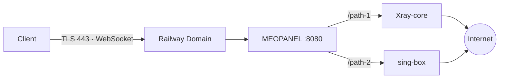

<p align="center">
  
</p>

<p align="center">
  
  
  
  
  
</p>

<div dir="rtl">

<h1 align="center">MEOPANEL</h1>

<p align="center">
پنل مدیریت پروکسی با پشتیبانی از <b>Xray-core</b> و <b>sing-box</b><br>
اینباند خودکار، کاربران با حجم و انقضا، صفحه‌ی اشتراک زیبا و دیپلوی سریع روی Railway
</p>

<p align="center">
<a href="#نمایی-از-پنل">نمایی از پنل</a> ·
<a href="#امکانات">امکانات</a> ·
<a href="#دیپلوی-روی-railway">دیپلوی روی Railway</a> ·
<a href="#اجرا-با-docker">Docker</a> ·
<a href="#شخصیسازی">شخصی‌سازی</a>
</p>

---

## نمایی از پنل

> تصاویر زیر با داده‌ی نمونه گرفته شده‌اند.

### ورود و داشبورد

<table>
  <tr>
    <td width="50%"></td>
    <td width="50%"></td>
  </tr>
  <tr>
    <td align="center"><b>صفحه‌ی ورود</b></td>
    <td align="center"><b>داشبورد</b></td>
  </tr>
</table>

### کاربران و اینباندها

<table>
  <tr>
    <td width="50%"></td>
    <td width="50%"></td>
  </tr>
  <tr>
    <td align="center"><b>مدیریت کاربران</b></td>
    <td align="center"><b>اینباندها (با امکان تغییر نام)</b></td>
  </tr>
</table>

### صفحه‌ی اشتراک کاربر

هر کاربر یک لینک اختصاصی دارد. وقتی لینک را در مرورگر باز کند، این صفحه را می‌بیند. برنامه‌های کلاینت (v2rayNG، Hiddify و ...) همان لینک را به‌عنوان اشتراک می‌خوانند.

<p align="center">
  
</p>

---

## امکانات

| | |
|---|---|
| **چند هسته** | Xray-core و sing-box، هر کدام به‌صورت پروسه‌ی جدا و با راه‌اندازی مجدد خودکار |
| **اینباند خودکار** | در اولین اجرا چهار اینباند (VLESS / VMess / Trojan روی WebSocket) با مسیر تصادفی ساخته می‌شود |
| **مدیریت اینباند** | ساخت، فعال/غیرفعال، حذف و تغییر نام از داخل پنل |
| **کاربران** | حجم، تاریخ انقضا، فعال/غیرفعال و ریست مصرف؛ کاربر منقضی یا تمام‌شده خودکار قطع می‌شود |
| **صفحه‌ی اشتراک** | لینک ساب، QR، اتصال سریع به برنامه‌ها و نمایش مصرف و روزهای باقی‌مانده |
| **امنیت ورود** | ورود با کوکی امضاشده، محدودیت تعداد تلاش و تغییر رمز اجباری در اولین ورود |
| **ظاهر** | تم تیره و روشن خودکار، انیمیشن‌های نرم و ریسپانسیو برای موبایل |
| **سبک و ساده** | بدون وابستگی npm؛ فقط Node.js و ذخیره‌ی اطلاعات در یک فایل |

---

## نحوه‌ی کار

Railway فقط یک پورت HTTP(S) عمومی می‌دهد. هسته‌ها روی `127.0.0.1` گوش می‌دهند و پنل، درخواست‌های WebSocket هر مسیر را به اینباند مربوط هدایت می‌کند. کلاینت با TLS روی پورت ۴۴۳ دامنه‌ی Railway وصل می‌شود.



---

## دیپلوی روی Railway

### ۱. Fork کردن پروژه

وارد GitHub شوید و پروژه را **Fork** کنید تا نسخه‌ای از آن در اکانت شما ذخیره شود.

### ۲. ورود به Railway

وارد **Railway** شوید و با حساب GitHub خود Login کنید.

### ۳. Deploy پروژه

روی **New Project** بزنید، گزینه‌ی **Deploy from GitHub repo** را انتخاب کنید و پروژه‌ی Fork‌شده را بردارید. ساخت پروژه چند دقیقه طول می‌کشد.

### ۴. اضافه کردن Volume

برای اینکه کاربران و تنظیمات بعد از هر دیپلوی پاک نشوند:

1. روی سرویس کلیک کنید و بخش **Volumes** را باز کنید.
2. یک Volume جدید بسازید.
3. مسیر Mount را روی `/data` بگذارید.

### ۵. تنظیم Variable

در بخش **Variables** این مقدار را اضافه کنید:

```
PORT=8080
```

### ۶. تنظیم Domain

1. وارد **Settings** شوید.
2. در بخش Networking روی **Generate Domain** کلیک کنید.
3. پورت را روی **8080** بگذارید.

### ۷. ورود به پنل

آدرس دامنه را در مرورگر باز کنید:

```
https://your-domain.up.railway.app
```

---

## اولین ورود

```
نام کاربری: admin
رمز عبور:   admin
```

بعد از اولین ورود، پنل شما را مجبور می‌کند رمز جدید بگذارید (حداقل ۶ کاراکتر).
**بلافاصله بعد از دیپلوی وارد شوید و رمز را عوض کنید.**
بعداً هم از بخش **تنظیمات** می‌توانید رمز و نام کاربری را تغییر دهید.

---

## اجرا با Docker

```
docker build -t meopanel .
docker run -d --name meopanel -p 8080:8080 -e PORT=8080 -v meopanel-data:/data --restart unless-stopped meopanel
```

> کلاینت‌ها با TLS روی پورت ۴۴۳ وصل می‌شوند. روی VPS باید جلوی پنل یک Reverse Proxy با گواهی TLS (مثل Caddy یا Nginx) بگذارید و دامنه را در بخش **تنظیمات** پنل وارد کنید.

---

## متغیرها

| متغیر | پیش‌فرض | توضیح |
|---|---|---|
| `PORT` | `3000` | پورتی که پنل روی آن گوش می‌دهد (روی Railway مقدار `8080` بگذارید) |
| `DATA_DIR` | `/data` (در Docker) | مسیر ذخیره‌ی اطلاعات؛ این مسیر باید Volume باشد |
| `ADMIN_USER` | `admin` | نام کاربری اولیه (اختیاری) |
| `ADMIN_PASS` | `admin` | رمز اولیه (اختیاری)؛ اگر چیز دیگری بگذارید، تغییر رمز اجباری نمی‌شود |

---

## شخصی‌سازی

برای استفاده از عکس لوگوی خودتان، در هر دو فایل `public/index.html` و `public/sub.html` مقدار `LOGO_IMAGE` را با آدرس عکس پر کنید:

```js
const LOGO_IMAGE='https://example.com/logo.png';
```

---

## ساختار فایل‌ها

```
meopanel/
├── Dockerfile
├── package.json
├── server.js          # سرور، API و مدیریت هسته‌ها
├── README.md
├── docs/              # تصاویر README
└── public/
    ├── index.html     # پنل و صفحه‌ی ورود
    └── sub.html       # صفحه‌ی اشتراک کاربر
```

---

## محدودیت‌ها

- فقط ترنسپورت WebSocket پشتیبانی می‌شود.
- حجم مصرفی هر کاربر فقط برای Xray ثبت می‌شود. برای sing-box ترافیک هر اینباند ثبت می‌شود.
- شرایط استفاده‌ی Railway را درباره‌ی سرویس‌های پروکسی و VPN بررسی کنید؛ ممکن است اکانت محدود شود.

---

## لینک‌ها

**GitHub:** [github.com/shaghayeghds/MEOPANEL](https://github.com/shaghayeghds/MEOPANEL)

**سازنده:** [@YOUR_ID](https://t.me/YOUR_ID) · **کانال:** [@YOUR_CHANNEL](https://t.me/YOUR_CHANNEL)

<p align="center"><b>MEOPANEL</b> · created by @YOUR_ID</p>

</div>
